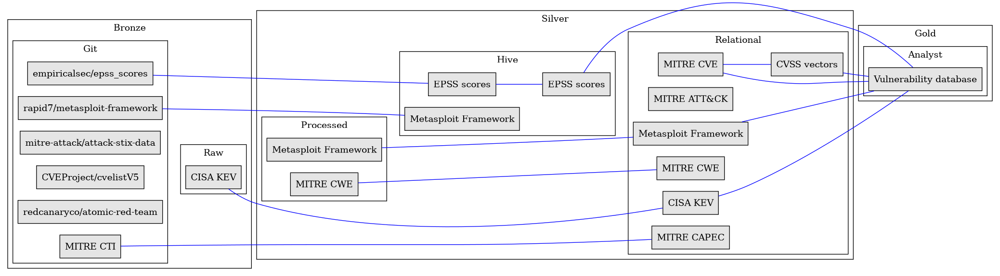

# Data pipeline

## Datasets

- MITRE ATT&CK
- MITRE CAPEC
- MITRE CWE
- CISA KEV
- EPSS
- Metasploit Framework




## Usage

Flows are currently manually run one-by-one

```bash
poetry run python3 -m pipeline.flows.git run
poetry run python3 -m pipeline.flows.cisa_kev run
poetry run python3 -m pipeline.flows.metasploit_framework run
poetry run python3 -m pipeline.flows.mitre_cve run
poetry run python3 -m pipeline.flows.cvss_vectors run
poetry run python3 -m pipeline.flows.mitre_attack run
poetry run python3 -m pipeline.flows.mitre_capec run
poetry run python3 -m pipeline.flows.epss run
poetry run python3 -m pipeline.flows.vulnerability_database run
```
